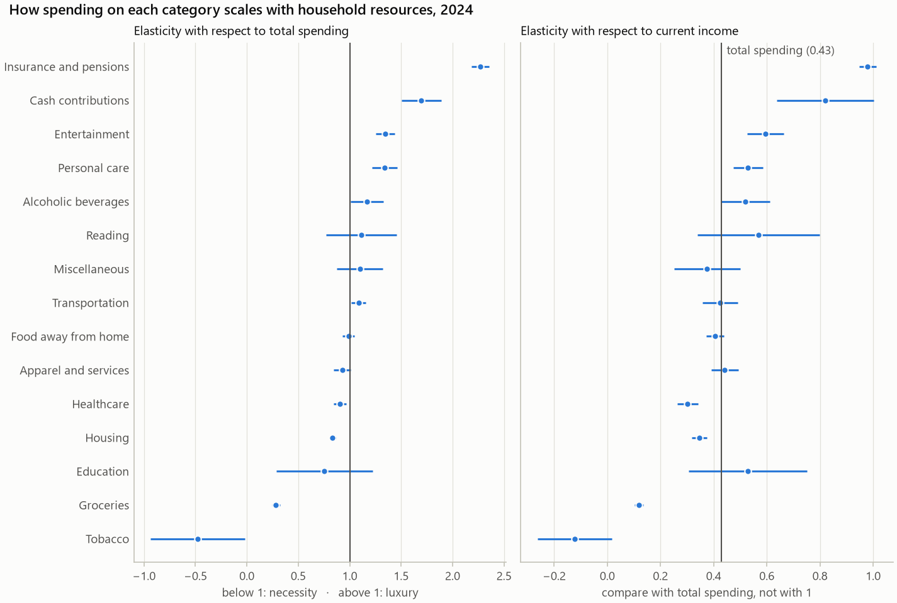
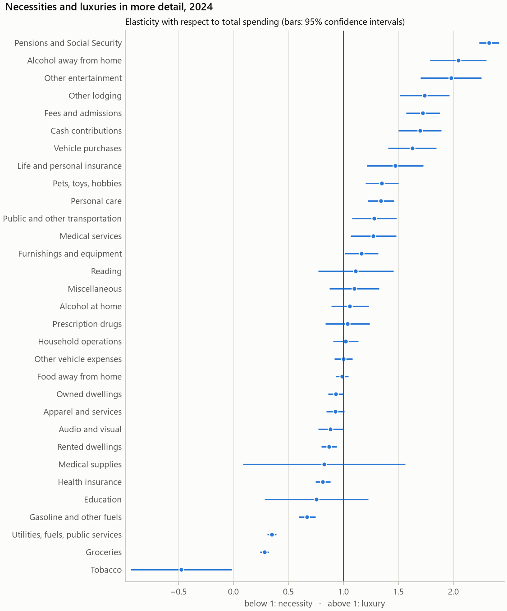
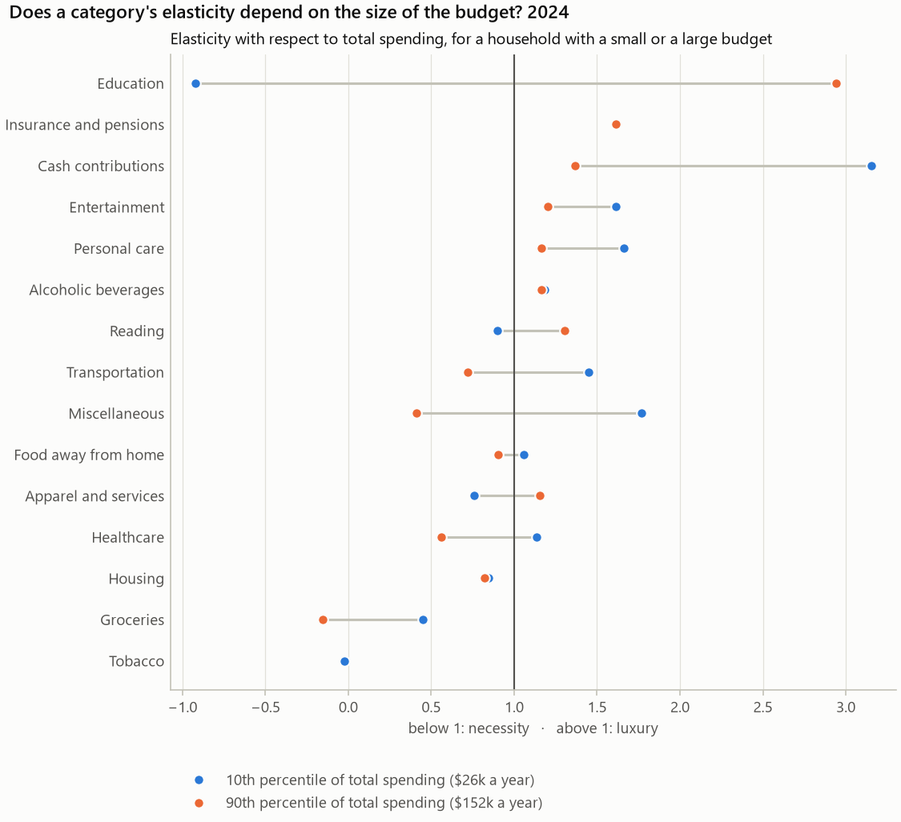
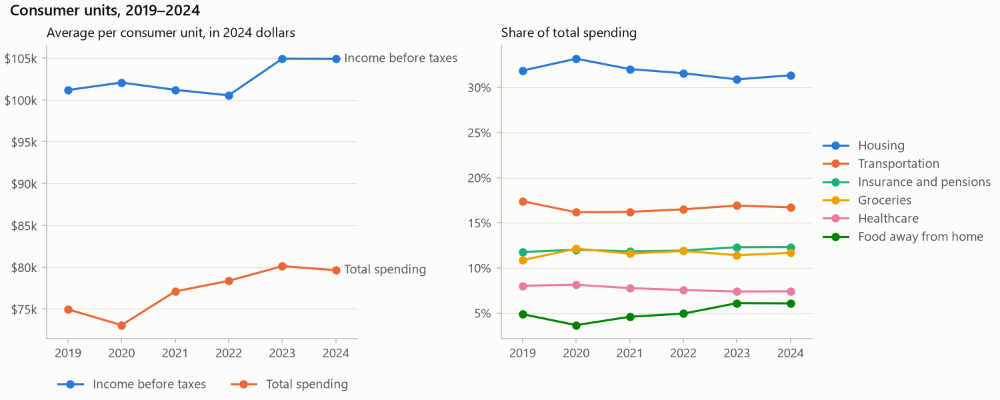
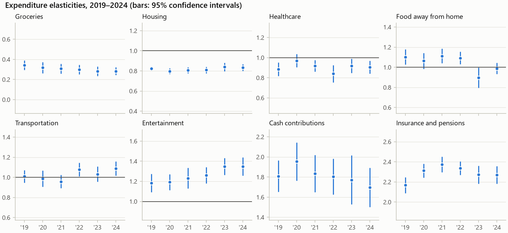
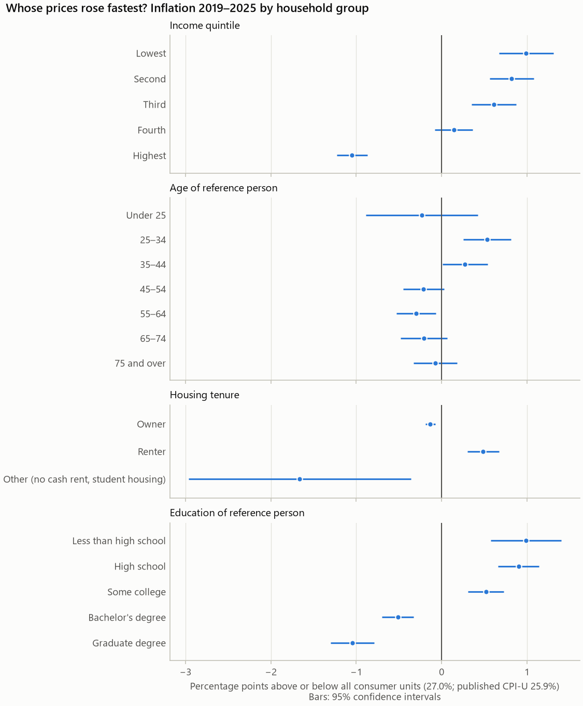

# consumer-expenditure

Load, clean, summarize, and model the BLS **Consumer Expenditure Survey (CE) Interview** public-use microdata, 2019–2024.

The repo is meant to be learned from. **[docs/guide.md](docs/guide.md) walks through the data and the methods step by step**, with the pitfalls found along the way. This README is the reference: how to run it and what comes out.

For each year, the pipeline:

- builds every household's spending from the item-level records, using BLS's own category tree, and checks it against BLS's published tables;
- reproduces BLS-style average annual spending per household, overall and by income quintile, age, region, education, and housing tenure, with budget shares and survey-correct standard errors;
- estimates **Engel curves**: how spending on each of 15 major and 31 detail categories scales with a household's total budget and with its income, and whether that changes between small and large budgets;
- reprices each group's basket with CPI series to measure **inflation as different households experienced it**;
- charts the results and, given several years, tracks real spending, budget shares, and elasticities over time.



## Setup

Requires [uv](https://docs.astral.sh/uv/) and Python 3.11+.

```sh
uv sync
```

## Get the data

```sh
uv run cex download --years 2019-2024 --contact you@example.com
# or: export CEX_CONTACT_EMAIL=you@example.com; uv run cex download --years 2024
```

This fetches three things into `data/raw/` (git-ignored):

| File | What | From |
|---|---|---|
| `intrvwYY.zip` | Interview microdata, about 50 MB a year | bls.gov |
| `stubs.zip` | BLS's category definitions for every year | bls.gov |
| `prices.csv` | 28 monthly CPI series | BLS public API |

BLS rejects anonymous scripted downloads of the first two. Its [access policy](https://www.bls.gov/bls/pss.htm) asks automated requests to include contact information, so `download` sends your email in the User-Agent header. The price API needs no contact details.

The 2020–2023 releases start at April–June; their January–March interviews are in the previous year's zip, which `download` fetches too. You can also download the zips yourself from the [CE PUMD page](https://www.bls.gov/cex/pumd_data.htm).

## Run

```sh
uv run cex run --years 2024           # one year
uv run cex run --years 2019-2024      # several years, plus multi-year tables and charts
uv run cex run --years 2019,2022-2024 --no-plots
```

`--data-dir` (holds `raw/` and `processed/`) and `--output-dir` default to `data/` and `outputs/` in this checkout. Set `CEX_HOME` to use another root. One year takes about a minute, mostly for the replicate-weight model fits.

### Outputs

Per year, in `outputs/<year>/`:

| File | Contents |
|---|---|
| `annual_means.csv` | Mean annual income and spending per consumer unit, budget share of each major category, standard errors |
| `group_means.csv` | The same, for major and detail categories, by income quintile, age group, region, education, and tenure (long format) |
| `detail_means.csv` | Means for every row of BLS's category tree, down to single items |
| `elasticities.csv` | Major categories: mean budget share, expenditure elasticity with 95% CI and classification, income elasticity with 95% CI, share of households with any spending |
| `detail_elasticities.csv` | Expenditure elasticities of the 31 detail categories |
| `engel_coefficients.csv` | All coefficients of the budget share model, per major category |
| `engel_curvature.csv` | Quadratic budget share model: curvature, and elasticities at the 10th, 50th, and 90th percentile of total spending |
| `inflation.csv` | Inflation from this year to the next for each group's basket, and the gap to all consumer units |
| `fmli_check.csv` | Rebuilt spending against BLS's ready-made summary variables, by quarter |
| `*.png` | Elasticities (major, detail, curvature), budget shares by income quintile, Engel curves |

For a multi-year run, in `outputs/<first>-<last>/`:

| File | Contents |
|---|---|
| `trends.csv` | Means in nominal and constant (latest-year) dollars, and budget shares, by year |
| `elasticities.csv` | The yearly elasticity tables stacked |
| `inflation.csv` | Cumulative inflation by group over the whole period |
| `inflation_contributions.csv` | Which categories account for each income quintile's gap |
| `*.png` | Trends, elasticities over time, inflation by group |

`data/processed/interviews_<year>.parquet` is the cleaned interview-level table behind all of it.

## Results

### Necessities and luxuries, 2024

Expenditure elasticities from `outputs/2024/elasticities.csv` (n = 11,547 households):

| Necessities (< 1) | | Luxuries (> 1) | |
|---|---|---|---|
| Groceries | 0.28 | Insurance and pensions | 2.27 |
| Housing | 0.83 | Cash contributions | 1.70 |
| Healthcare | 0.90 | Entertainment | 1.35 |
| | | Personal care | 1.34 |
| | | Alcoholic beverages | 1.17 |
| | | Transportation | 1.09 |

Food away from home (0.99), apparel, reading, education, and miscellaneous can't be distinguished from 1. Tobacco is an inferior good: households that spend more in total spend less on it.

The 31 detail categories pull the major ones apart. Within housing, utilities (0.35) are far more of a necessity than lodging away from home (1.74). Within transportation, gasoline (0.67) is a necessity and vehicle purchases (1.63) a luxury.



Elasticities also depend on the size of the budget. Transportation and healthcare are luxuries for households at the 10th percentile of spending and necessities at the 90th:



### 2019–2024

Real spending per household fell in 2020, recovered by 2021, and by 2024 was about 6% above 2019. Elasticities of the large categories move little from year to year: groceries stay between 0.28 and 0.34, housing between 0.80 and 0.84.

One break to keep in mind: BLS changed the questionnaire in April 2023. Dining out now includes alcohol bought with the meal, so from then on food away from home is about 30% higher and alcohol away from home about 65% lower than before. Movements in those categories between 2022 and 2023 reflect the new questions, not behavior.





### Whose prices rose fastest?

Repricing each group's own basket year by year from 2019 to 2025 gives 27.0% inflation for all consumer units (published CPI-U: 25.9%). Households in the lowest income fifth faced about 1 percentage point more, and those in the highest about 1 point less.



## Methods

The [guide](docs/guide.md) explains each of these. In brief:

**Data.** A calendar year uses five quarterly files of each type: January–March of the year through January–March of the next. Each FMLI row is one consumer unit (CU, roughly a household) in one quarterly interview covering the previous three months. A CU is interviewed up to four times.

**Spending** is added up from the item-level records (MTBI, and ITBI for pension and Social Security deductions) using the tree of categories in BLS's stub file for the year. BLS's ready-made FMLI summary variables are read only as a cross-check, because their definitions change over time (`outputs/<year>/fmli_check.csv`). One category departs from BLS's naming: `groceries` is all grocery-store purchases, nonfood items included, because the food-only figure is not collected after early 2023.

**Annual means** follow BLS's method. Each interview contributes only the months of its recall period that fall in the calendar year, and the population is the sum of `FINLWT21 × months in scope / 12`. Budget shares are ratios of means. Income quintiles come from BLS's within-quarter income ranks (`INC_RNK1`–`5`).

**Standard errors** combine two sources:
- Sampling error, from the 44 replicate weights: variance = Σ(replicate − full)² / 44.
- Uncertainty in imputed income. BLS imputes missing income five times (`FINCBTX1`–`5`). Anything that involves income is estimated once per imputation and combined with Rubin's rules.

**Household-year data for the models.** A single quarter is a noisy measure of spending: a car purchase shows up as a huge outlay, and a quarter without one as zero. The models therefore average each CU's annualized spending over its interviews in the year's files.

**Expenditure elasticities.** A Working–Leser budget share model, `share = a + b·log(total spending) + controls`, estimated by two-stage least squares with log income as the instrument for log total spending.
- The elasticity is `1 + b / mean share`.
- Because shares sum to 1, the share-weighted elasticities average exactly 1, which makes 1 the necessity/luxury line.
- Households with zero spending in a category stay in the sample.
- Why instrument: measured total spending shares its noise with its components. The first stage is strong (F ≈ 1,200 in 2024).
- Controls: log family size, age group, education, region, tenure, urban, sex of the reference person, numbers of children and of seniors.
- The quadratic version adds the square of log total spending, instrumented with the square of log income.

**Income elasticities.** Poisson pseudo-maximum likelihood (PPML) of spending on log income and the same controls, which also keeps zero spenders. These are much smaller than the expenditure elasticities: the income elasticity of *total* spending is only 0.43 in 2024. So 1 is **not** the dividing line for these; compare each category with the row for total spending.

**Inflation by group.** A Laspeyres index per group: its budget shares over the 28 detail categories that have a CPI series, times each series' change to the next year, chained across years. Owners' shelter enters at the rental value of the home, as in the CPI. Every group is assumed to face the same price change within a category.

**Constant dollars** use annual-average CPI-U (`src/cex/cpi.py`). Add new years there as BLS publishes them.

## Validation

`tests/test_bls_published.py` compares every downloaded year with BLS's published tables. This pipeline as a ratio to the published figure:

| | 2019 | 2020 | 2021 | 2022 | 2023 | 2024 |
|---|---|---|---|---|---|---|
| Consumer units | 1.000 | 1.000 | 1.000 | 1.000 | 1.000 | 1.000 |
| Income before taxes | 0.995 | 0.998 | 1.000 | 0.998 | 1.001 | 1.007 |
| Cash contributions | 1.000 | 1.000 | 1.000 | 1.000 | 1.000 | 0.989 |
| Insurance and pensions | 1.003 | 1.001 | 1.001 | 0.998 | 1.002 | 1.001 |
| Transportation | 0.989 | 0.992 | 0.985 | 0.981 | 0.999 | 1.000 |
| Total spending | 0.969 | 0.983 | 0.995 | 1.002 | 1.007 | 1.014 |

The published tables combine the Interview and Diary surveys, while this pipeline uses the Interview alone. Categories that BLS takes entirely from the Interview match almost exactly. The total differs because food, apparel, and small household items are published from the Diary.

## Caveats

- Interview survey only. Category levels are not comparable with BLS's published tables where those use the Diary.
- `groceries` includes nonfood items bought at grocery stores (see Methods).
- The April 2023 questionnaire change breaks the series for food away from home and alcohol (see Results). Other categories may be affected to a smaller degree.
- A household-year averages only the interviews that fall in that year's files: one or two for most households.
- The inflation comparison uses national price indexes for broad categories. It shows the effect of what groups buy, not of what they pay.
- Years before 2019 have not been run. The stub reader handles 2015 onward; earlier files are laid out differently.
- Multi-year runs need a CPI value in `src/cex/cpi.py` for every year (2004–2024 are included).

## Development

```sh
uv run pytest              # synthetic-data tests, plus the BLS comparison for any year that is downloaded
uv run ruff check && uv run ruff format --check
```

GitHub Actions runs both on Python 3.11 and 3.13. The tests build synthetic releases with known answers and the real files' quirks, so they check that the models recover a known budget-share slope and a known income elasticity, and that the elasticities add up to 1.

```
src/cex/
  download.py   fetch the Interview zips and category definitions from BLS
  prices.py     CPI series from the BLS API
  load.py       find and read the quarterly FMLI, MTBI, and ITBI files
  stubs.py      BLS's category tree: which item codes make up which category
  clean.py      interview table (traits, income, weights), household-year aggregation
  spending.py   spending by category from item-level records, cross-check with FMLI
  dataset.py    one year assembled from all of the above
  survey.py     replicate-weight and multiple-imputation variance
  summarize.py  annual means, budget shares, group tables, trends
  model.py      Engel curves: budget-share IV, PPML, quadratic
  inflation.py  inflation by household group
  plots.py      charts
  cpi.py        CPI-U for constant dollars
  cli.py        `cex download` / `cex run`
docs/guide.md   a walk through the data and methods
```
